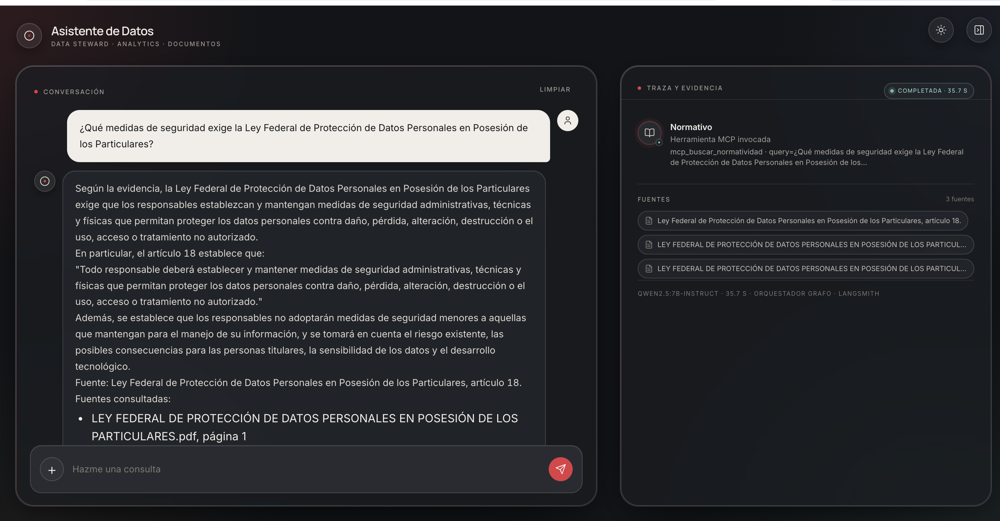

# Proyecto — Agente Multi-Agente Bancario

Sistema **Data Steward & Data Analyst** para Banamex. Integra una base sintética,
agentes con herramientas, servidores MCP, recuperación normativa y una interfaz
Streamlit que expone la traza de cada turno.

Se encuentra en estado beta funcional: consulta la base sintética por MCP, ejecuta
SQL de solo lectura y construye la respuesta con el resultado de las herramientas.
Los casos que aún fallan se documentan con su causa.

El proyecto comenzó con un Data Steward sobre `proyecto/data/clientes.csv`. Esa
etapa fue reemplazada por la base sintética SQLite que se describe en este
documento; el historial de esa primera versión permanece en Git.

## Arquitectura

El orquestador ocupa el centro: recibe la consulta, decide qué especialistas
participan y distribuye el trabajo. Ningún especialista invoca a otro; todos
leen y escriben en el estado compartido del grafo.

```text
  ┌───────────────────┐                            ┌───────────────────┐
  │    Data Steward   │                            │    Data Analyst   │
  │ metadatos/calidad │                            │  SQL solo lectura │
  └─────────┬─────────┘                            └─────────┬─────────┘
            │                                                │
            │             ┌───────────────────┐              │
            └─────────────│    Orquestador    │──────────────┘
            ┌─────────────│     LangGraph     │──────────────┐
            │             └───────────────────┘              │
            │                                                │
  ┌─────────▼─────────┐                            ┌─────────▼─────────┐
  │  Normatividad RAG │                            │      Document     │
  │      Pinecone     │                            │    Intelligence   │
  └───────────────────┘                            └───────────────────┘
```

Las conexiones son de ida y vuelta: el orquestador despacha y recibe resultados.
Data Steward y Data Analyst se comunican por MCP `stdio` con
`proyecto/bd/banamex.db`; Normatividad consulta el índice Pinecone; Document
Intelligence utiliza Ollama con Qwen2.5-VL sobre una imagen local. Streamlit
presenta la respuesta y la traza de herramientas.

`compliance` (KYC/AML) dispone de un servidor MCP de demostración y el grafo lo
utiliza para rechazar ese tipo de consultas; las reglas reales quedan para fase 2.

## Requisitos

- Python >= 3.12 y [`uv`](https://docs.astral.sh/uv/).
- Ollama >= 0.40.15 (`mimo-v2.6` requiere esa versión, según los requisitos del equipo).
- Los modelos oficiales por agente se leen de `proyecto/config/models.yaml`;
  ese archivo es la fuente de sus nombres y asignaciones.
- En equipos de 16 GB los modelos compiten por memoria; Ollama descarga de
  memoria el que queda inactivo.
- Claves de Pinecone para el corpus normativo (`PINECONE_API_KEY`, `INDEX_NAME`).

Preparar el entorno Python si aún no existe, desde la raíz del repositorio:

```bash
uv sync
```

Abre Ollama o ejecuta `ollama serve`. Después comprueba los modelos:

```bash
uv run python -m proyecto.config.preparar_modelos
uv run python -m proyecto.config.preparar_modelos --instalar
```

El primer comando comprueba el servicio y los modelos; termina con código 1
si faltan modelos y 2 si hay un error de conexión o configuración. El segundo
instala solo los faltantes con sus nombres oficiales y verifica el resultado.
Las descargas ocupan varios GB. Abre Ollama (o ejecuta `ollama serve`) antes.
Se respeta `OLLAMA_HOST` si está definido. Los mismos comandos funcionan en
macOS, Linux y PowerShell con `uv` instalado.

`.env.example` sirve como plantilla de `.env`. `DATABASE_URL` es opcional: si no
se define, se usa la ruta de `proyecto/config/data_connection.yaml` y, en su
defecto, `proyecto/bd/banamex.db`. `MCP_TIMEOUT` (segundos, 180 por defecto)
limita cada llamada MCP `stdio` para que una tool colgada no bloquee la UI. El
valor por defecto cubre el arranque en frío de Ollama; si tu equipo es más lento,
súbelo en `.env`.

## Base sintética

La base SQLite se regenera desde el script SQL:

```bash
uv run python proyecto/bd/cargar_bd.py
```

El comando crea `proyecto/bd/banamex.db` con las tablas y vistas que utilizan el
Data Steward y el Data Analyst. El archivo está en `.gitignore`: en un clon
nuevo, el cargador debe ejecutarse antes de consultar datos.

Las herramientas del Data Steward calculan conteos de estructura y calidad. No
envían al modelo filas ni valores personales: reportan nombres de columnas, tipos
detectados y cantidades agregadas. Un identificador repetido se reporta para
revisión, no como instrucción para borrar datos. La clave de duplicados sale de
la PK/restricción única o de `calidad_hallazgos_esperados`, no de una heurística
por nombre. `evaluar_calidad` compara lo encontrado contra esos hallazgos
esperados y marca coincidencias y diferencias.

## Interfaz Streamlit

Streamlit se instala al vuelo para no cargar el entorno base. Desde la raíz:

```bash
uv run --with streamlit streamlit run proyecto/ui/app.py
```

El panel de traza muestra, por turno, la herramienta MCP invocada, sus
argumentos, el estado, la consulta SQL, la gráfica y las fuentes. La interfaz
también admite imágenes para OCR o descripción y documentos locales (PDF, DOCX,
XLSX, PPTX, CSV, HTML y texto) para convertirlos a Markdown.

Ejemplo de una consulta de normatividad con evidencia y fuentes:



## Agentes, modelos y herramientas

| Agente | Descripción | Modelo | Herramientas MCP |
|---|---|---|---|
| `orchestrator` | Enruta la consulta y compone la respuesta | `mimo-v2.6` | — |
| `data_steward` | Gobierno y calidad de datos bancarios | `qwen2.5:7b-instruct` | `inspeccionar_dataset`, `validar_calidad_datos`, `evaluar_calidad` |
| `data_analyst` | Análisis cuantitativo sobre datos bancarios | `mimo-v2.6` | `analizar_datos`, `listar_tablas`, `describir_tabla`, `valores_columna`, `validar_sql`, `ejecutar_consulta`, `graficar_consulta`, `catalogo_metricas`, `consultar_metrica`, `resolver_periodo`, `resolver_valor`, `verificar_cifras` |
| `normatividad_rag` | Búsqueda semántica sobre documentación | `llama3.1:latest` | `buscar_normatividad`, `buscar_evidencia`, `verificar_cita` |
| `document_intelligence` | Lectura de imágenes y documentos | `qwen2.5vl:7b` | `extraer_texto_imagen`, `describir_imagen`, `convertir_documento_markdown` |
| `compliance` | Reglas regulatorias: KYC, AML | `qwen2.5:7b-instruct` | `revisar_compliance_demo` (demostración, fase 2) |

`convertir_documento_markdown` usa **MarkItDown** para convertir PDF, DOCX,
XLSX, PPTX, CSV, HTML y texto local a Markdown. No hace OCR: si un PDF es
escaneado y no tiene capa de texto, devuelve un aviso y requiere el flujo de
OCR/visión sobre las páginas convertidas a imagen. El resultado de OCR,
descripción o Markdown se entrega al orquestador, que decide qué responder al
cliente en lugar de mostrar el texto crudo directamente.

En el Data Analyst, `analizar_datos` recibe la pregunta en lenguaje natural y la
resuelve con las herramientas SQL (`listar_tablas`, `describir_tabla`,
`valores_columna`, `validar_sql` y `ejecutar_consulta`). `validar_sql` revisa el
AST con `sqlglot`: una sola sentencia, catálogo real, solo lectura, PII y
row-level security (`num_cte` del cliente o una `num_cta` que le pertenezca).
Las tools auxiliares también aplican el alcance del perfil. El agente usa
`mimo-v2.6`: en las pruebas, `qwen2.5-coder:7b` describió las tablas pero no
ejecutó las herramientas SQL.

`graficar_consulta` no ejecuta código generado por el modelo: valida y ejecuta
una consulta agregada y dibuja el PNG con matplotlib en el backend. Rechaza
identificadores, datos personales, resultados truncados, ejes no numéricos y
categorías repetidas. El grafo y el hub pueden generarla cuando el usuario pide
una gráfica; la UI la muestra y permite descargarla desde `Respuesta.grafica`.

Para evitar SQL libre en preguntas frecuentes, `catalogo_metricas` declara
métricas cerradas (clientes, saldo, transacciones, importes) con sus dimensiones
y `consultar_metrica` las ejecuta con allowlist. `resolver_periodo` convierte
expresiones como `2026-02`, `1T 2026` o `mes pasado` a claves de `dim_fecha`;
`resolver_valor` normaliza una categoría antes del `WHERE`. `verificar_cifras`
contrasta cifras y PII de la redacción contra la evidencia de la última consulta.

El hub nuevo de Data Analyst vive en `proyecto/orchestration/hubs.py` y usa esas
tools de bajo nivel, sin `analizar_datos`. Para compararlo con el flujo MCP
anterior en el grafo:

```bash
DATA_ANALYST_HUB=1 uv run python -c \
  "from proyecto.orchestration.grafo import ejecutar_grafo; print(ejecutar_grafo('¿Cuántos clientes hay?')['respuesta'])"
```

El orquestador usa `mimo-v2.6` para las respuestas directas; en modo `hub`
también enruta cuando las reglas deterministas no alcanzan.

## Integración MCP

Todos los especialistas se exponen como servidores MCP y el grafo los invoca por
`stdio`, con un subproceso por llamada:

| Servidor | Archivo |
|---|---|
| Data Steward | `proyecto/mcp_servers/data_steward_server.py` |
| Data Analyst | `proyecto/mcp_servers/data_analyst_server.py` |
| Normatividad | `proyecto/mcp_servers/normatividad_rag_server.py` |
| Document Intelligence | `proyecto/mcp_servers/document_intelligence_server.py` |
| Compliance | `proyecto/mcp_servers/compliance_server.py` (demostración, fase 2) |

El orquestador no describe la base en el prompt: solicita metadatos o ejecuta SQL
y devuelve el resultado de la herramienta.

## RAG de gobernanza

El agente `normatividad_rag` responde únicamente con evidencia recuperada:

- **Corpus** (`data_governance_files/`): Ley Federal de Protección de Datos
  Personales en Posesión de los Particulares, Ley de Protección y Defensa al
  Usuario de Servicios Financieros, Ley para Regular las Sociedades de
  Información Crediticia, Circular Única de Bancos, Aviso de Privacidad Integral
  de Banamex, Aviso legal y Términos y condiciones Citibanamex.
- **Índice**: Pinecone (`INDEX_NAME`), embeddings `llama-text-embed-v2`,
  fragmentos de 1200 caracteres con 150 de traslape y `k = 3` documentos.
- **Prompt**: la evidencia es la única fuente válida; prohíbe usar conocimiento
  previo, inventar artículos o plazos, y obliga a citar archivo y página. Si la
  evidencia no alcanza, la respuesta lo declara.
- **Enrutamiento**: las preguntas normativas de alta confianza (leyes, privacidad,
  avisos, políticas) se envían directo al servidor de normatividad con el texto
  original, para que el modelo no reformule la pregunta y pierda artículos.
- **Evidencia cruda**: `buscar_evidencia` devuelve fragmentos con `fuente`,
  `pagina`/`fila` y `cita_id` sin sintetizar. `verificar_cita` comprueba que una
  cita textual exista en la evidencia recuperada; `buscar_normatividad` se
  conserva por compatibilidad. Las tres reutilizan la misma recuperación
  cacheada por consulta: no repiten la búsqueda en Pinecone.

Para reindexar el corpus:

```bash
uv run python data_governance_files/upload_files.py
```

El RAG cubre preguntas de un solo tema. La relación entre la normativa y los
datos almacenados no está resuelta; se detalla en el diagnóstico.

## Casos de prueba

La tabla siguiente resume los resultados de la demo del 4 de noviembre. **Sí**
indica respuesta correcta y **No**, fallo.

### Casos que funcionan

| Pregunta | Agente | Resultado |
|---|---|---|
| ¿Qué dice la Ley Federal de Protección de Datos Personales en Posesión de los Particulares? | Normatividad | Sí: cita artículos y fuente (archivo y página). |
| ¿Qué dice la ley de protección de datos por privados? | Normatividad | Sí: el enrutamiento de alta confianza reconoce la variante y responde con la misma evidencia. |
| ¿Qué dice el aviso de privacidad de Banamex sobre el tratamiento de datos personales? | Normatividad | Sí: recupera el aviso y responde con citas. |
| ¿Cuál es el promedio de los sueldos? | Data Analyst | Sí: se enruta como agregado y responde. La base sintética no tiene columna `sueldo`; la respuesta debe declarar el proxy utilizado o la ausencia del dato. |
| ¿Qué problemas de calidad tiene `raw_clientes`? | Data Steward | Sí: nombra la tabla y devuelve faltantes, duplicados y claves repetidas reales. |
| Adjuntar una factura y pedir el texto | Document Intelligence | Sí: transcribe el contenido visible con OCR. |
| ¿Y en enero? (después de una consulta de saldos) | Data Analyst | Sí: la memoria de corto plazo conserva el hilo y reutiliza el contexto. |

### Casos que fallan

| Pregunta | Agente | Síntoma | Causa |
|---|---|---|---|
| ¿Cuál es la estructura de las tablas? | Data Steward | No: alucina y agrega columnas que no existen, por ejemplo "puntaje de buró de crédito". | Sin tabla explícita, el verificador no contrasta la salida contra el esquema real y la síntesis rellena el hueco. |
| ¿Qué relación tiene la ley de protección de datos con los datos almacenados? | Normatividad (solo) | No: no conecta los dos puntos; se queda en la fase de recuperación del RAG. | Falta un plan multiagente que cruce evidencia normativa con metadatos. El plan actual enruta a un solo especialista. |
| Consultas SQL complejas (varios joins, condiciones o pasos) | Data Analyst | No: el ciclo no termina; se corta antes de verificar y sintetizar. | El orquestador de 9B no sostiene el plan; el verificador reintenta una sola vez y no hay descomposición en pasos. |
| Preguntas donde el agente debe pedir una aclaración al usuario | Cualquiera | No: se interrumpe el turno. | No existe un nodo de aclaración: el grafo no puede suspender la ejecución para preguntar y retomar. |
| Preguntas que exigen inferir entre dos ideas | Cualquiera | No: responde una parte o cambia de tema. | El sintetizador compone bloques, no razona sobre ellos; no hay contraste entre evidencias. |

### Diagnóstico

El análisis de los casos anteriores señala que el origen principal de los fallos
está en el orquestador, no en los especialistas:

1. El plan es determinista y de un solo paso; cuando la pregunta necesita dos
   fuentes, elige una y descarta la otra.
2. El verificador comprueba que el especialista respondió, pero no que lo dicho
   exista en el esquema; de ahí que aparezcan columnas inventadas.
3. No hay nodo de aclaración, por lo que una pregunta incompleta interrumpe el
   ciclo en lugar de volver al usuario.
4. Los modelos de 7-9B sostienen bien una herramienta aislada, pero pierden el
   hilo en consultas SQL largas o en inferencias.

Las conclusiones son preliminares y se basan en los casos observados. La
siguiente iteración abordará esta parte del orquestador.

### Formulación de consultas

Los mejores resultados se obtienen cuando la consulta es explícita y nombra la
tabla o la herramienta:

| Vago | Explícito |
|---|---|
| ¿Cuál es la estructura de las tablas? | Inspecciona la tabla `raw_clientes` con el Data Steward. |
| ¿Cómo va lo de los clientes? | ¿Cuántos clientes hay por tipo de persona en la base sintética? |
| ¿Y lo de la ley? | ¿Qué dice la Ley Federal de Protección de Datos Personales sobre el consentimiento? |

En general, una consulta con una sola idea, la tabla nombrada y el agente o la
herramienta explícitos produce mejores resultados.

## Orquestación en grafo

El contrato de tareas, resultados y hubs de dominio vive en
`proyecto/orchestration/tareas.py` y `proyecto/orchestration/hubs.py`. Es el
diseño que permite que el orquestador delegue objetivos de alto nivel y cada hub
decida qué herramientas usar.

`proyecto/orchestration/grafo.py` implementa un `StateGraph` de LangGraph con
estado compartido:

```text
planear -> despachar -> especialista -> despachar -> ... -> verificar
   ^                                                         |
   └──────────────── reintento (máximo 1) ──────────────────┘
                                                             |
                                                        sintetizar
```

- `planear` decide rutas con reglas deterministas y auditables.
- `despachar` ejecuta los especialistas en orden y comparte el estado.
- `verificar` revisa si todos los especialistas respondieron; si alguno falló,
  reintenta una vez. El reintento es único: el fallo típico de un modelo pequeño
  es de planificación, y repetir el mismo plan no lo corrige, solo suma latencia. Si
  el reintento también falla, el sintetizador responde con lo que sí llegó y deja
  el error visible en la traza.
- `sintetizar` compone la respuesta final. Si hay un solo especialista, conserva
  su salida verificada; si hay varios, presenta cada bloque con su agente.
- Antes de formatear, el nodo de Data Steward valida el contrato de las tools
  (tipos y rangos de los agregados). Una salida fuera de contrato se reporta como
  error y no se publica.
- El estado guarda `plan`, `resultados`, `trazas`, `errores` e `intentos`.
- El modo se controla con `ORCHESTRATION_MODE`:
  - `graph` (por defecto): usa LangGraph.
  - `hub`: usa el orquestador anterior como respaldo.
  - Si el grafo falla, se intenta el hub para no dejar la interfaz sin respuesta.

La comunicación entre agentes es por estado compartido, no por llamadas directas
entre servidores MCP. Así el verificador y el sintetizador pueden ver la evidencia
de todos los especialistas sin crear una malla de dependencias.

## Estructura

```text
proyecto/
├── config/
│   ├── models.yaml           # Modelo por agente (documentación; ver Configuración)
│   ├── data_connection.yaml  # Fuente de datos (SQLite banamex.db)
│   └── memory.yaml           # Memoria de largo plazo (desactivada)
├── bd/
│   ├── crear_bd.sql          # Script de la base sintética de Banamex
│   └── cargar_bd.py          # Genera banamex.db
├── agents/
│   ├── data_steward_agent.py
│   ├── normatividad_rag_agent.py
│   ├── data_analyst_agent.py
│   ├── document_intelligence_agent.py
│   └── compliance_agent.py
├── mcp_servers/              # Servidores MCP por especialista
├── orchestration/
│   ├── grafo.py              # Grafo LangGraph
│   └── orquestador.py        # Adaptador de modos y hub de respaldo
├── ui/                       # Streamlit, estilos y panel de traza
├── servicio.py               # Contrato entre UI y orquestador
└── main.py                   # CLI
```

## Pruebas

La suite automatizada se ejecuta con:

```bash
uv run pytest -q
```

Cubre el guard SQL, RLS por identidad, métricas, periodos, gráficas, hubs,
tareas y autenticación local.

Las pruebas manuales (`tests/probar_*.py`, `tests/rag_test.py` y la imagen de
factura) no se publican en el repositorio; se conservan localmente para
desarrollo. Los servidores MCP también pueden verificarse de forma aislada desde
esos scripts locales.

## Configuración

La conexión a datos se toma de `config/data_connection.yaml`, que apunta a
`proyecto/bd/banamex.db`. Cuando `DATABASE_URL` está definida, tiene prioridad.

La memoria de largo plazo se configura en `config/memory.yaml` y está desactivada
por defecto.

El modelo de cada agente se toma de `config/models.yaml` al inicializar el agente.
Si el archivo o la entrada faltan, se usa el valor por defecto de
`proyecto/config/models.py`. `DOCUMENT_INTELLIGENCE_MODEL` sobrescribe el modelo
de visión.

## Límites conocidos

Estos límites corresponden a la arquitectura y a las pruebas con agentes:

- El plan es determinista y de un solo paso: ante preguntas que requieren dos
  fuentes, prioriza una y descarta la otra.
- El verificador valida que el especialista respondió, no que el contenido exista
  en el esquema; de ahí que puedan aparecer columnas inexistentes.
- No existe un nodo de aclaración: una pregunta incompleta interrumpe el ciclo en
  lugar de volver al usuario.
- Los modelos de 7-9B resuelven bien una herramienta aislada, pero pierden
  consistencia en SQL largo o en inferencias entre fuentes.
- La suite automatizada cubre contratos y seguridad; las pruebas de calidad de
  respuesta con LLM siguen siendo manuales y dependen de Ollama/Pinecone.

## Siguientes pasos

1. **Plan multi-paso**: descomponer las preguntas que cruzan normativa y datos, y
   ejecutar los especialistas en secuencia.
2. **Nodo de aclaración**: permitir que el grafo suspenda el turno, pregunte y
   retome la ejecución.
3. **Verificador contra esquema**: contrastar las tablas y columnas citadas con
   los metadatos antes de publicar la respuesta.
4. **Suite de evaluación**: convertir los casos de evaluación en pruebas
   repetibles por agente, con criterios de aceptación.
5. **Comparación de modelos**: medir 14B y 32B con la misma suite para evaluar el
   efecto en planificación e inferencia.


## Acceso local y modo demo

La interfaz exige login y usa las identidades existentes en AppData. El modo
visual `demo` del equipo se conserva como opcion de presentacion, pero nunca
crea un auditor anonimo ni concede acceso a todos los clientes. El valor
predeterminado es `PROYECTO_AUTH_MODE=local`; incluso si se indica `demo`, los
permisos de datos requieren una sesion autenticada real.

Se conservan `render_login`, `identidad_actual` y `cerrar_sesion` para los
consumidores del componente del equipo. La pantalla principal usa `render_access`
con tema, validacion por rerun y borrado del historial al cerrar sesion.
No hay selector de rol: el operador aprovisiona identidades y permisos.

```bash
uv run python -m proyecto.security.local_auth --usuario usuario_prueba --rol normal --clientes 1
uv run python -m proyecto.security.local_auth --usuario auditor_prueba --rol auditor --clientes 1,2,25 --permisos audit,aggregate,governance,pii:nombre,pii:rfc
```

Estos son ejemplos de asignacion del operador, no identidades precargadas:
confirma primero que la fuente es de prueba y que existe autorizacion para
esos clientes. La clave se pide por consola (minimo 16 caracteres), se deriva
con PBKDF2-SHA256 y no se versiona. Para consultas globales el operador debe
otorgar explicitamente todo el alcance necesario; `aggregate` no amplia el
conjunto de clientes. `audit` habilita auditorias dentro de ese conjunto y los
campos personales necesitan permisos adicionales. El chat nunca modifica roles.

La sesion opaca dura una hora y puede revocarse al cerrar sesion. Esta ligada
al archivo y SHA-256 de SQLite: si cambia la base hay que reprovisionar una
identidad autorizada; no se reutiliza automaticamente contra otra fuente.
En Windows, los registros privados y la auditoria se guardan fuera del repositorio
y de OneDrive, en `%LOCALAPPDATA%\ProyectoFinalFinal\auth\<id-del-proyecto>`.
La consola, Streamlit y los procesos MCP calculan la misma ruta para este proyecto.
Ejecuta todos con tu usuario habitual de Windows, sin administrador. Puedes consultar
la ubicacion efectiva sin leer credenciales:

```powershell
.\.venv\Scripts\python.exe -m proyecto.security.local_auth --ruta
```

`PROYECTO_AUTH_DIR` permite configurar otra carpeta privada; si lo usas, debe tener
el mismo valor en la consola y en Streamlit. No compartas ese directorio, claves,
tokens ni capturas con datos personales. La carpeta antigua `.local_auth/` no se
borra ni se alteran sus permisos y sigue excluida de Git. Si puedes leer legitimamente
su registro, `--migrar-desde <ruta-a-identities.json>` importa identidades con sus
hashes y permisos sin sobrescribir identidades distintas ni importar sesiones.
Tras cambiar de ubicacion, reinicia Streamlit desde tu consola habitual.

Ejecuta el servicio solo en localhost para desarrollo:

```bash
uv run --with streamlit streamlit run proyecto/ui/app.py --server.address 127.0.0.1
```

Las consultas de Data Analyst usan una proyeccion SQLite efimera en memoria,
limitada por `dim_cuenta.num_cte -> dim_cliente.num_cte` y por `num_cta` en
saldos y movimientos. El SQL no puede acceder al archivo fuente ni usar ATTACH
ni escrituras. La fuente se abre en mode=ro; no se modifica ni regenera.
Data Steward exige `governance` para sus agregados de calidad. Los historiales
son por sesion. Las consultas sensibles registran sujeto, rol, alcance resumido
y hash SQL, sin nombres, cuentas, consultas literales ni resultados personales.
Se desactiva el trazado externo durante consultas autenticadas sensibles.

Este mecanismo confia en el operador y en el acceso al sistema de archivos del
usuario de Windows. No es un proveedor de identidad de produccion: quien puede
editar el registro o leer la base fuera de la aplicacion pertenece a esa frontera
de confianza. Aprovisiona fuera de sesiones activas; para despliegues compartidos
se necesita un IdP, gestion de secretos, almacenamiento transaccional de sesiones
y controles de acceso del sistema operativo. No se ampliaron los permisos de
Compliance ni sus capacidades de demostracion.


### Respuestas verificadas de las preguntas bancarias

Data Analyst reconoce intenciones acotadas de productos, saldos, movimientos,
gastos, crecimiento, agregados y auditoria. Construye SELECT de solo lectura
con periodos e identificadores tipados y ejecuta la herramienta SQL existente
sobre el alcance autenticado. La tabla visible y el SQL proceden de esa ejecucion,
sin una segunda reformulacion que cambie filas o cifras. No hay cuentas bloqueadas
globalmente. Las consultas no reconocidas conservan el agente general con el
modelo oficial; sus llamadas tienen limite de espera.

Normatividad intenta Pinecone con espera acotada. Si no esta disponible,
recupera fragmentos literales de los PDF/TXT reales de `data_governance_files`,
indicando archivo, pagina y modo local. El lector PDF usa `pypdf`, ya presente
en el entorno; si falta, debe prepararse esa dependencia antes de leer PDF.
Esto no certifica conectividad Pinecone ni vigencia legal externa del corpus.
Las respuestas locales no usan conocimiento inventado del modelo.

Las pruebas de gobierno de datos son adaptaciones explicitas a `raw_clientes`
y `raw_saldos` de SQLite, no recreaciones de `clientes.csv`. Las herramientas
reportan conteos de negativos y clasificacion PII por nombres del esquema,
sin mostrar valores individuales.

Pruebas focalizadas de autorizacion (fixture aislada, sin Ollama ni datos reales):

```bash
uv run python -m unittest discover -s tests -p test_local_authorization.py -v
```


### Login visual y sesiones

La pantalla de acceso usa la autenticacion local anterior, sin otro registro ni
selector de permisos. Aprovisiona tu usuario con el comando de la seccion
"Autenticacion local de desarrollo" (la clave se pide por consola; no hay una
clave de demostracion fija). Abre Streamlit con el Python de `.venv` y entra con
ese identificador y clave. El login y el chat permiten cambiar entre claro y
oscuro. Cerrar sesion revoca el token y descarta el historial; una sesion vencida
vuelve al acceso. Los permisos se validan de nuevo en el backend y MCP.

### Mitigacion provisional de MiMo en Windows

Se reprodujo el error CUDA en Ollama 0.40.16 durante el calentamiento de Flash
Attention. Con `use_mmap=true` se observaron una carga directa y otra a traves
del orquestador exitosas por GPU. Esto es una mitigacion observada, **no una
reparacion garantizada del fallo intermitente** ni una prueba de causa unica.
No se cambiaron controladores, modelos, servicio ni configuracion de Windows.

`proyecto/config/ollama_runtime.py` envia esa opcion dentro de `options` de la
solicitud para MiMo en Windows; el constructor original de la version instalada
de LangChain no la serializa por si solo. Los demas modelos conservan sus
opciones. Para desactivar la mitigacion solo en la terminal actual:

```powershell
$env:PROYECTO_OLLAMA_MMAP = "0"
```

Para volver al comportamiento de la aplicacion, elimina esa variable de la
terminal (`Remove-Item Env:PROYECTO_OLLAMA_MMAP`). No uses `setx` ni cambies `.env`.
Referencias: [carga predeterminada de Ollama en Windows/CUDA](https://github.com/ollama/ollama/blob/main/server/sched.go)
y [reporte de fallo intermitente de memoria del host](https://github.com/ollama/ollama/issues/17380).
La similitud de ese reporte con los registros locales no demuestra que sea
la misma causa en este equipo.


### Conciliacion local de autenticacion y hubs

Las mejoras de hubs, metricas y graficas se conservan con autenticacion
obligatoria. El `perfil` recibido por API/MCP orienta el flujo pero no concede
roles: el alcance y los permisos provienen de la sesion real de AppData. El hub
opcional mantiene instancias separadas por sesion y conserva la ruta MCP para
los planes bancarios verificados. No se habilita ningun auditor anonimo.

La evidencia y los limites posteriores a la integracion estan en
`docs/reporte_validacion_preguntas.md`. No se repitieron las 30 preguntas.
La prueba manual existente `tests/probar_data_analyst_mcp.py` se conserva local
(segun la exclusion del equipo) y ahora verifica MCP real y Streamlit sin
guardar contrasenas ni alterar la base. Las pruebas unitarias del equipo usan
identidades reales sobre fixtures aisladas; no requieren acceso anonimo.

### Filtro semántico de documentos adjuntos

Los adjuntos documentales de Streamlit se convierten con MarkItDown/MCP y se
comparan, antes del orquestador, con cuatro referencias internas mediante
`bge-large:latest` local. No son normativa oficial ni se agregan a Pinecone/RAG.
Este filtro identifica similitud de tipo; no certifica autenticidad, cumplimiento
legal ni permisos para acceder a datos. Imágenes y OCR conservan su flujo previo;
un PDF sin texto extraíble informa un error y no se clasifica como irrelevante.

Preparación explícita, una vez por equipo/checkout, con los cuatro PDF legítimos
en Downloads (ajusta las rutas si los guardaste en otro lugar):

```powershell
ollama pull bge-large:latest
$pdf = Join-Path $env:USERPROFILE 'Downloads'
.\.venv\Scripts\python.exe -m proyecto.agents.document_similarity --referencias "$pdf\01_Normativa_Data_Governance_COMPLICADA.pdf" "$pdf\01_Normativa_Data_Governance_LIMPIA.pdf" "$pdf\02_Estados_Cuenta_Banamex_Referencia_COMPLEJA.pdf" "$pdf\02_Estados_Cuenta_Banamex_Referencia_LIMPIA.pdf" --calibracion tests/fixtures/document_similarity_calibration.json
```

El registro guarda vectores normalizados, nombres, hashes de los PDF, identidad
del modelo y evidencia de calibración en
`%LOCALAPPDATA%\ProyectoFinalFinal\document_similarity\<id-del-proyecto>\references.json`.
Ese archivo no copia PDF ni guarda texto o embeddings de uploads. No es una base vectorial.
`PROYECTO_DOCUMENT_REFERENCES_DIR` permite otra ubicación privada; debe ser la misma
para la preparación y Streamlit. No la pongas en el repositorio ni OneDrive.

Se comparan hasta 24 fragmentos repartidos por el documento mediante coseno;
cada fragmento aporta su mejor coincidencia con cada referencia y se promedian
las coincidencias. Se toma la referencia con mayor puntuación. Los límites se
calculan con ejemplos sintéticos etiquetados separados de la validación: mínimo
de positivos para aceptar, máximo de negativos para rechazar. Entre ambos es
indeterminado; si no hay separación en la calibración, no se habilita el filtro.
Cambiar el modelo, las referencias o el algoritmo requiere preparar/calibrar otra
vez. Los límites se guardan, no se recalculan por upload.

Solo un resultado aceptado puede continuar al procesamiento generativo. Un indeterminado solicita más
evidencia sin llamarlo irrelevante; los fallos de Ollama, extracción o caché son
errores técnicos. La traza muestra decisión, modelo, similitudes y tiempo. Las
similitudes no son porcentajes de confianza. La calibración actual es pequeña:
no se garantiza generalización a todos los documentos financieros.

Pruebas focalizadas, sin inferencia generativa:

```powershell
.\.venv\Scripts\python.exe -m pytest tests/test_document_similarity.py -q -p no:cacheprovider
# Opcional: requiere referencias preparadas y Ollama; ejecuta los cuatro PDF sintéticos por MCP.
$env:VALIDAR_EMBEDDINGS_REAL = '1'
.\.venv\Scripts\python.exe -m pytest tests/test_document_similarity.py -k lote_mcp_real -q -s -p no:cacheprovider
Remove-Item Env:VALIDAR_EMBEDDINGS_REAL
```

### Preguntas sobre el adjunto aceptado

Tras admitir un documento, Document Intelligence prepara fragmentos con
`bge-large:latest` por MCP. Se conservan **en memoria de la sesión de Streamlit**,
ligados al token autenticado, usuario, base y alcance de permisos. No se guardan
en el caché de referencias, Pinecone ni otro índice persistente. Una nueva
subida reemplaza el contexto anterior; limpiar el chat o cerrar sesión lo descarta.

Las preguntas se comparan por coseno con todos los fragmentos y se recuperan
los cuatro más próximos. La similitud ordena evidencia, pero no prueba que haya
una respuesta: no se reutilizan los umbrales de admisión como si fueran límites
de respuesta. Se comprueba apoyo textual; las preguntas claramente ajenas se
detienen con las reglas existentes y los conceptos solicitados ausentes producen
"sin evidencia". Una pregunta ambigua puede requerir reformularla o revisión
del selector de evidencia; este filtro conservador no certifica todos los idiomas
ni todas las paráfrasis posibles.

MiMo usa la configuración y mitigación existentes para seleccionar **citas
literales**, no para inventar una respuesta libre. Cada cita y su fragmento se
validan antes de mostrarse. En PDF se indican páginas reales obtenidas mediante
pdfplumber; otros formatos citan secciones de MarkItDown. Los fragmentos completos
sin evidencia de respuesta no se muestran como si respondieran la pregunta.

La suma de cargos utiliza `Decimal` sobre una columna inequívoca de una tabla
extraída con separadores `|`, mostrando operandos y resultado. No se estima
un total cuando faltan encabezados/importes, hay páginas sin texto o filas
ambiguas. Otros diseños de tabla requieren extracción inequívoca: no se delega
la aritmética al modelo. La evidencia y el cálculo aparecen en la traza.

Los seguimientos reutilizan el adjunto y la última pregunta documental sin
volver a subirlo. El control "Consultar el documento adjunto" permite regresar
al asistente general. Las peticiones explícitas a SQLite, Data Analyst, Data
Steward o normativa oficial mantienen su ruta aunque el control esté activo.
La autorización existente se comprueba tanto en el servicio como en MCP; subir
un PDF no amplía permisos ni convierte sus datos en normativa oficial.

Pruebas nuevas, sin repetir el lote de admisión:

```powershell
.\.venv\Scripts\python.exe -m pytest tests/test_document_questions.py -q -p no:cacheprovider
```

#### Alcance y resultados de las preguntas documentales

El documento aceptado no autoriza cualquier finalidad. La ruta documental
reutiliza `grafo.fuera_de_alcance` antes de recuperar evidencia o invocar MiMo.
Solicitudes explícitas de inventar historias, cuentos o canciones se rechazan
aunque mencionen compras, saldos o un PDF. Analizar un historial, resumir datos
o verificar un texto no equivale a pedir ficción. Las preguntas de calidad del
documento permanecen en su contexto; no se convierten en consultas a SQLite.
Permitir esa pregunta no certifica cumplimiento sin criterios y evidencia.

MCP comprueba la admisión del archivo real al preparar su contexto; no confía
en el texto sustituido por el cliente. Reutiliza el clasificador, modelo y caché
existentes: no regenera las cuatro referencias. Esta comprobación adicional es
por subida, no por pregunta. Los contextos anteriores sin metadatos de admisión
deben reconstruirse subiendo el documento otra vez; no se aprueban por defecto.

El campo `code` distingue `DOCUMENTO_FUERA_DE_ALCANCE`,
`PREGUNTA_FUERA_DE_ALCANCE`, `SIN_EVIDENCIA`, `ACCESO_DENEGADO` y
`ERROR_TECNICO`; `OK` indica respuesta válida. Se conserva además
`DOCUMENTO_INDETERMINADO` para no llamar rechazado a un archivo inconcluyente.
Los fallos del modelo, de extracción o embeddings no se presentan como ausencia
de datos. Autenticación, permisos y pertenencia del contexto se verifican antes
de responder; una coincidencia semántica no amplía permisos.

Estas reglas son conservadoras, no un clasificador universal del lenguaje:
paráfrasis o intenciones mezcladas ambiguas pueden necesitar aclaración.

#### Autorización del archivo y del contexto documental

La subida documental se guarda ahora bajo el almacén privado de la autenticación
local (`auth_directory()/documents/<huella-de-sesión>/`). El servidor crea un
identificador opaco y registra ruta, propietario de sesión, alcance y SHA-256 en
el registro de la sesión existente. Ese identificador no es otra credencial:
siempre exige el token, identidad, permisos y vigencia del login actual.
No se registra una ruta arbitraria enviada por el cliente.

Antes de abrir un documento, servicio, herramientas MCP y respaldo local
comprueban ese registro. `validar_tipo_documental` requiere `documento_id`;
su argumento antiguo `texto` no acredita autorización y no se vectoriza.
`file_path` de conversión/preparación admite el identificador o una ruta ya
registrada para esa misma sesión, nunca una ruta ajena por sí sola.

Orden: identidad y permiso del archivo → validación del formato/tamaño →
extracción local controlada de Markdown y páginas → autorización de los datos
identificados en **todas** esas representaciones → protección de campos
personales → admisión por embeddings → preparación de fragmentos autorizados →
alcance de la pregunta y recuperación → cálculo o selección de citas por MiMo.
No se intenta adivinar la identidad de una persona por su nombre. Los números de
cuenta/cliente se verifican con el autorizador existente; identificadores
enmascarados, campos sin límites verificables o tablas de identidad ambiguas
se deniegan conservadoramente, sin enviarlos a embeddings ni al LLM.

Solo la huella del contexto se guarda en el registro privado; sus textos y
vectores siguen en memoria de Streamlit. MCP verifica la huella completa, la
sesión, el alcance y el archivo: modificar los fragmentos o una bandera de
admisión en el cliente no da acceso. Se revalida antes y después de responder y
entre lotes de embeddings. Antes de renderizar historial/artefactos se repite la
comprobación; cambios de rol, permisos o clientes invalidan el contexto anterior.
Expiración y logout se rigen por la autenticación existente, sin otro sistema.

Los originales son temporales: logout y limpiar chat solicitan su eliminación;
la expiración se limpia de forma oportunista al entrar al contexto autenticado,
con hasta 64 intentos por llamada. Una extracción activa o un archivo bloqueado
dejan el borrado pendiente para reintentar. Sin actividad de la aplicación no
hay limpieza en segundo plano. Los huérfanos sin registro requieren revisión
local conservadora; no se eliminan carpetas completas ni referencias internas.
No se guardan vectores de uploads en una base nueva ni se incorporan a Pinecone.
El usuario de Windows que administra el almacén sigue siendo confiable, como en
el login local: esto no protege frente a un administrador del equipo. La
autorización semántica de datos personales implícitos en texto libre no es un
clasificador infalible, ni se certifica autenticidad del PDF frente a su emisor.
Los formatos o titularidades ambiguos pueden requerir clasificación confiable o
revisión; no se deben ampliar permisos para evitar esas denegaciones.

Pruebas rápidas de seguridad, sin SQLite, navegador ni inferencias reales:

```powershell
.\.venv\Scripts\python.exe -m pytest tests/test_document_access.py -q -p no:cacheprovider
```

Las pruebas reales opcionales anteriores se adaptaron a referencias registradas
e identidades autorizadas, pero no se reejecutaron tras este cambio de seguridad.
Las corridas históricas con rutas libres o identificadores sintéticos opacos no
certifican el contrato nuevo. El flujo de visión/OCR de imágenes queda fuera de
esta revisión documental; no se presenta como auditado por estas pruebas.

#### Integridad de documentos admitidos (reglas, sin otro modelo)

Después de autorizar, extraer, proteger los datos y comprobar la admisión,
`preparar_documento_consultable` aplica las reglas de `document_questions.py`.
El informe se incorpora al contexto firmado de la sesión, sin otro agente,
almacén o historial. Se vuelve a comprobar el permiso en MCP para consultarlo.

El perfil de conciliación de débito o estado de cuenta genérico exige importes de resumen
etiquetados: `Saldo inicial`, `Total de abonos`/`Abonos`, `Total de cargos`/`Cargos`
y `Saldo final` (también `Saldo al cierre`/`Saldo de cierre`), con separador `:`
o `|` y un importe inequívoco. Son requisitos de esta comprobación contable,
no una lista de obligaciones legales. Reutiliza el parser monetario existente
y `Decimal`: saldo inicial + abonos - cargos = saldo final, sin tolerancias
ni estimaciones. Se muestran operandos, resultado esperado y páginas/secciones.
No verifica transacción por transacción ni atribuye una diferencia a fraude.

Las fechas etiquetadas de emisión, inicio/fin y vencimiento/vigencia se leen
en formato ISO `AAAA-MM-DD` o `DD/MM/AAAA`. Se comprueba su existencia en el
calendario, contradicciones y vencimiento explícito a la fecha local del servidor.
La fecha de evaluación queda registrada en el informe; se actualiza al consultar
en otro día. Un estado de cuenta histórico no caduca por antigüedad. No se
inventan vigencias y no se interpretan todos los formatos de fecha en prosa.
La numeración explícita `Página N de M` permite señalar saltos o contradicciones;
un salto no prueba por sí solo que se haya perdido físicamente una página.

El resultado `integridad_documental` está separado de `validacion_documental`
(admisión semántica) y de los códigos de autorización/errores técnicos. Contiene
un estado principal y varias incidencias con estado, campo/regla, explicación
y página cuando está disponible: `VALIDO`, `INCOMPLETO`, `VENCIDO`,
`INCONSISTENTE`, `OBSERVACION` y `NO_EVALUABLE`. `VALIDO` solo significa que
pasaron las reglas implementadas, nunca autenticidad, oficialidad o certificación.
Un campo mencionado pero no parseable se distingue de uno no encontrado; con
extracción parcial o texto insuficiente no se afirma que falte en el original.
Los fallos de extracción que ya impiden la admisión conservan `ERROR_TECNICO`.

La UI muestra el resumen al subir y el informe en la traza. Se pueden preguntar
las incidencias sin LLM. Los problemas críticos bloquean conclusiones y totales
globales; siguen disponibles citas literales autorizadas con advertencia. No
hay todavía perfiles de campos obligatorios para políticas de gobierno de datos
u otros tipos, ni requisitos de expedientes definidos en el flujo actual: no se
declaran completos ni se inventan archivos faltantes. La función admite una
lista de requisitos del servidor para cuando exista una operación definida;
no recibe esa lista desde el documento o la pregunta del usuario.

Pruebas nuevas focalizadas, sintéticas y con extracción/embeddings/LLM simulados
(no ejecutan las comprobaciones anteriores):

```powershell
.\.venv\Scripts\python.exe -m pytest tests/test_document_questions.py tests/test_document_access.py -k integridad -q
```

#### Pertinencia contextual y temporal del adjunto

La ruta segura del adjunto reutiliza el planificador de orquestación:
`grafo.interpretar_finalidad_documental` identifica contenido, consulta histórica,
período específico, versión específica, actualidad y la intención de verificar
calidad/cumplimiento, sin otro clasificador LLM. El servicio registra esa finalidad;
MCP la vuelve a calcular sobre la pregunta y seguimiento autorizados. Las consultas
explícitas a SQLite o al corpus normativo conservan sus rutas existentes.

Document Intelligence reconoce etiquetas en los primeros encabezados del texto
protegido: débito, crédito, estado de cuenta genérico, normativa/reglamento,
política de gobierno de datos y otro compatible. Este reconocimiento es limitado,
no un clasificador universal ni una nueva decisión de admisión. Extrae versión,
período, corte, límite de pago, emisión, vigencia declarada, ámbito, controles,
referencias y artículos/secciones cuando sus etiquetas son reconocibles. Se conservan
el texto literal y la página de cada dato dentro del contexto firmado de la sesión.

La conciliación existente se aplica a débito/genéricos, no a crédito ni normativa.
En crédito se comprueban fechas explícitas y contradicciones corte/límite de pago,
sin interpretar un saldo deudor con la fórmula de débito. No existe un perfil
completo de todos los conceptos crediticios. Normas y políticas tienen revisión
general de fechas/páginas y consulta citada de secciones; no certificación legal
ni perfiles completos de campos obligatorios. Otros compatibles permiten citas
y análisis limitado, aunque su integridad global permanezca `NO_EVALUABLE`.

Antes de recuperar fragmentos por embeddings o llamar al LLM se comprueba:

- Un período/versión solicitado debe estar identificado y ser compatible; enero
  no demuestra gastos de todo un año. Períodos contradictorios no se eligen por
  inferencia. Se reconocen meses en español con año, rangos ISO/DD-MM expresados
  como `AAAA-MM-DD a AAAA-MM-DD` o `DD/MM/AAAA a DD/MM/AAAA`, y campos explícitos
  de inicio/fin. No se interpreta cualquier fecha escrita en prosa.
- El saldo o pago de un estado histórico no acredita una obligación actual.
- El PDF no prueba que una norma/política sea la última versión o siga vigente,
  aunque declare una vigencia futura. La recuperación RAG existente aporta citas,
  pero no un verificador de derogaciones, sustituciones o actualidad jurídica;
  sin corroboración autorizada no se confirma vigencia. Los cuatro PDF de
  referencia son ejemplos sintéticos, nunca fuentes oficiales.
- Si falta precisar período o finalidad, se devuelve `REQUIERE_ACLARACION`.
  Si falta evidencia compatible o actualizada, `SIN_EVIDENCIA`. Estos códigos
  siguen separados del estado de integridad y la admisión del archivo.

Las respuestas históricas se delimitan al período/versión del documento. Se mantienen
las citas, cálculos, filtros de alcance, autorización previa y posterior, aislamiento
y limpieza temporal. El panel de trazas muestra metadatos, finalidad y pertinencia.
Los embeddings ordenan evidencia; no demuestran vigencia ni actualidad financiera.

Pruebas exclusivamente nuevas, sintéticas y con funciones simuladas:

```powershell
.\.venv\Scripts\python.exe -m pytest tests/test_document_questions.py -k pertinencia -q
```
