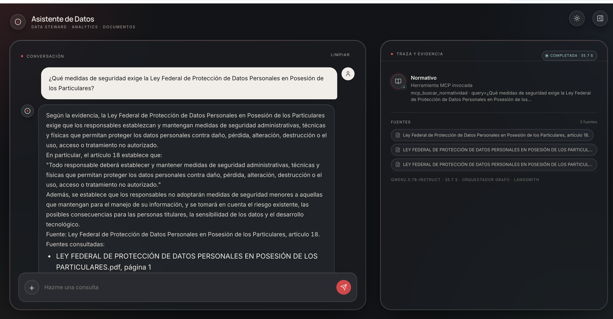

# Proyecto — Agente Multi-Agente Bancario

Sistema **Data Steward & Data Analyst** para Banamex. Integra una base sintética,
agentes con herramientas, servidores MCP, recuperación normativa y una interfaz
Streamlit que expone la traza de cada turno.

Se encuentra en estado beta funcional: consulta la base sintética por MCP, ejecuta
SQL de solo lectura y construye la respuesta con el resultado de las herramientas.
Los casos que aún fallan se documentan con su causa.

El proyecto comenzó con un Data Steward sobre `proyecto/data/clientes.csv`. Esa
etapa fue reemplazada por la base sintética SQLite que se describe en este
documento; el historial de esa primera versión permanece en Git.

## Arquitectura

El orquestador ocupa el centro: recibe la consulta, decide qué especialistas
participan y distribuye el trabajo. Ningún especialista invoca a otro; todos
leen y escriben en el estado compartido del grafo.

```text
  ┌───────────────────┐                            ┌───────────────────┐
  │    Data Steward   │                            │    Data Analyst   │
  │ metadatos/calidad │                            │  SQL solo lectura │
  └─────────┬─────────┘                            └─────────┬─────────┘
            │                                                │
            │             ┌───────────────────┐              │
            └─────────────│    Orquestador    │──────────────┘
            ┌─────────────│     LangGraph     │──────────────┐
            │             └───────────────────┘              │
            │                                                │
  ┌─────────▼─────────┐                            ┌─────────▼─────────┐
  │  Normatividad RAG │                            │      Document     │
  │      Pinecone     │                            │    Intelligence   │
  └───────────────────┘                            └───────────────────┘
```

Las conexiones son de ida y vuelta: el orquestador despacha y recibe resultados.
Data Steward y Data Analyst se comunican por MCP `stdio` con
`proyecto/bd/banamex.db`; Normatividad consulta el índice Pinecone; Document
Intelligence utiliza Ollama con Qwen2.5-VL sobre una imagen local. Streamlit
presenta la respuesta y la traza de herramientas.

`compliance` (KYC/AML) dispone de un servidor MCP de demostración y el grafo lo
utiliza para rechazar ese tipo de consultas; las reglas reales quedan para fase 2.

## Requisitos

- Python >= 3.12 y [`uv`](https://docs.astral.sh/uv/).
- Ollama >= 0.40.15 (`mimo-v2.6` requiere esa versión, según los requisitos del equipo).
- Los modelos oficiales por agente se leen de `proyecto/config/models.yaml`;
  ese archivo es la fuente de sus nombres y asignaciones.
- En equipos de 16 GB los modelos compiten por memoria; Ollama descarga de
  memoria el que queda inactivo.
- Claves de Pinecone para el corpus normativo (`PINECONE_API_KEY`, `INDEX_NAME`).

Preparar el entorno Python si aún no existe:

```powershell
uv sync
```

Abre Ollama o ejecuta `ollama serve`. Desde PowerShell, en la raíz del
repositorio y con el entorno virtual ya preparado:

```powershell
.\.venv\Scripts\python.exe -m proyecto.config.preparar_modelos
.\.venv\Scripts\python.exe -m proyecto.config.preparar_modelos --instalar
```

El primer comando comprueba el servicio y los modelos; termina con codigo 1
si faltan modelos y 2 si hay un error de conexion o configuracion. El segundo
instala solo los faltantes con sus nombres oficiales y verifica el resultado.
Las descargas ocupan varios GB. Abre Ollama (o ejecuta `ollama serve`) antes.
Se respeta `OLLAMA_HOST` si esta definido. Pega solo el comando, sin el prompt
ni la salida de PowerShell. No requiere nuevas dependencias Python.

`.env.example` sirve como plantilla de `.env`. `DATABASE_URL` es opcional: si no
se define, se usa la ruta de `proyecto/config/data_connection.yaml` y, en su
defecto, `proyecto/bd/banamex.db`.

## Base sintética

La base SQLite se regenera desde el script SQL:

```bash
uv run python proyecto/bd/cargar_bd.py
```

El comando crea `proyecto/bd/banamex.db` con las tablas y vistas que utilizan el
Data Steward y el Data Analyst. El archivo está en `.gitignore`: en un clon
nuevo, el cargador debe ejecutarse antes de consultar datos.

Las herramientas del Data Steward calculan conteos de estructura y calidad. No
envían al modelo filas ni valores personales: reportan nombres de columnas, tipos
detectados y cantidades agregadas. Un identificador repetido se reporta para
revisión, no como instrucción para borrar datos.

## Interfaz Streamlit

```bash
.\.venv\Scripts\python.exe -m streamlit run proyecto/ui/app.py
```

El panel de traza muestra, por turno, la herramienta MCP invocada, sus
argumentos, el estado, la consulta SQL y las fuentes. La interfaz también admite
imágenes para OCR o descripción.

Ejemplo de una consulta de normatividad con evidencia y fuentes:



## Agentes, modelos y herramientas

| Agente | Descripción | Modelo | Herramientas MCP |
|---|---|---|---|
| `orchestrator` | Enruta la consulta y compone la respuesta | `mimo-v2.6` | — |
| `data_steward` | Gobierno y calidad de datos bancarios | `qwen2.5:7b-instruct` | `inspeccionar_dataset`, `validar_calidad_datos` |
| `data_analyst` | Análisis cuantitativo sobre datos bancarios | `mimo-v2.6` | `analizar_datos`, `listar_tablas`, `describir_tabla`, `valores_columna`, `ejecutar_consulta` |
| `normatividad_rag` | Búsqueda semántica sobre documentación | `llama3.1:latest` | `buscar_normatividad` |
| `document_intelligence` | Lectura de imágenes y documentos | `qwen2.5vl:7b` | `extraer_texto_imagen`, `describir_imagen` |
| `compliance` | Reglas regulatorias: KYC, AML | `qwen2.5:7b-instruct` | `revisar_compliance_demo` (demostración, fase 2) |

En el Data Analyst, `analizar_datos` recibe la pregunta en lenguaje natural y la
resuelve con las cuatro herramientas SQL (`listar_tablas`, `describir_tabla`,
`valores_columna` y `ejecutar_consulta`). El agente usa `mimo-v2.6`: en las
pruebas, `qwen2.5-coder:7b` describió las tablas pero no ejecutó las
herramientas SQL.

El orquestador usa `mimo-v2.6` para las respuestas directas; en modo `hub`
también enruta cuando las reglas deterministas no alcanzan.

## Integración MCP

Todos los especialistas se exponen como servidores MCP y el grafo los invoca por
`stdio`, con un subproceso por llamada:

| Servidor | Archivo |
|---|---|
| Data Steward | `proyecto/mcp_servers/data_steward_server.py` |
| Data Analyst | `proyecto/mcp_servers/data_analyst_server.py` |
| Normatividad | `proyecto/mcp_servers/normatividad_rag_server.py` |
| Document Intelligence | `proyecto/mcp_servers/document_intelligence_server.py` |
| Compliance | `proyecto/mcp_servers/compliance_server.py` (demostración, fase 2) |

El orquestador no describe la base en el prompt: solicita metadatos o ejecuta SQL
y devuelve el resultado de la herramienta.

## RAG de gobernanza

El agente `normatividad_rag` responde únicamente con evidencia recuperada:

- **Corpus** (`data_governance_files/`): Ley Federal de Protección de Datos
  Personales en Posesión de los Particulares, Ley de Protección y Defensa al
  Usuario de Servicios Financieros, Ley para Regular las Sociedades de
  Información Crediticia, Circular Única de Bancos, Aviso de Privacidad Integral
  de Banamex, Aviso legal y Términos y condiciones Citibanamex.
- **Índice**: Pinecone (`INDEX_NAME`), embeddings `llama-text-embed-v2`,
  fragmentos de 1200 caracteres con 150 de traslape y `k = 3` documentos.
- **Prompt**: la evidencia es la única fuente válida; prohíbe usar conocimiento
  previo, inventar artículos o plazos, y obliga a citar archivo y página. Si la
  evidencia no alcanza, la respuesta lo declara.
- **Enrutamiento**: las preguntas normativas de alta confianza (leyes, privacidad,
  avisos, políticas) se envían directo al servidor de normatividad con el texto
  original, para que el modelo no reformule la pregunta y pierda artículos.

Para reindexar el corpus:

```bash
uv run python data_governance_files/upload_files.py
```

El RAG cubre preguntas de un solo tema. La relación entre la normativa y los
datos almacenados no está resuelta; se detalla en el diagnóstico.

## Casos de prueba

La tabla siguiente resume los resultados de la demo del 4 de noviembre. **Sí**
indica respuesta correcta y **No**, fallo.

### Casos que funcionan

| Pregunta | Agente | Resultado |
|---|---|---|
| ¿Qué dice la Ley Federal de Protección de Datos Personales en Posesión de los Particulares? | Normatividad | Sí: cita artículos y fuente (archivo y página). |
| ¿Qué dice la ley de protección de datos por privados? | Normatividad | Sí: el enrutamiento de alta confianza reconoce la variante y responde con la misma evidencia. |
| ¿Qué dice el aviso de privacidad de Banamex sobre el tratamiento de datos personales? | Normatividad | Sí: recupera el aviso y responde con citas. |
| ¿Cuál es el promedio de los sueldos? | Data Analyst | Sí: se enruta como agregado y responde. La base sintética no tiene columna `sueldo`; la respuesta debe declarar el proxy utilizado o la ausencia del dato. |
| ¿Qué problemas de calidad tiene `raw_clientes`? | Data Steward | Sí: nombra la tabla y devuelve faltantes, duplicados y claves repetidas reales. |
| Adjuntar una factura y pedir el texto | Document Intelligence | Sí: transcribe el contenido visible con OCR. |
| ¿Y en enero? (después de una consulta de saldos) | Data Analyst | Sí: la memoria de corto plazo conserva el hilo y reutiliza el contexto. |

### Casos que fallan

| Pregunta | Agente | Síntoma | Causa |
|---|---|---|---|
| ¿Cuál es la estructura de las tablas? | Data Steward | No: alucina y agrega columnas que no existen, por ejemplo "puntaje de buró de crédito". | Sin tabla explícita, el verificador no contrasta la salida contra el esquema real y la síntesis rellena el hueco. |
| ¿Qué relación tiene la ley de protección de datos con los datos almacenados? | Normatividad (solo) | No: no conecta los dos puntos; se queda en la fase de recuperación del RAG. | Falta un plan multiagente que cruce evidencia normativa con metadatos. El plan actual enruta a un solo especialista. |
| Consultas SQL complejas (varios joins, condiciones o pasos) | Data Analyst | No: el ciclo no termina; se corta antes de verificar y sintetizar. | El orquestador de 9B no sostiene el plan; el verificador reintenta una sola vez y no hay descomposición en pasos. |
| Preguntas donde el agente debe pedir una aclaración al usuario | Cualquiera | No: se interrumpe el turno. | No existe un nodo de aclaración: el grafo no puede suspender la ejecución para preguntar y retomar. |
| Preguntas que exigen inferir entre dos ideas | Cualquiera | No: responde una parte o cambia de tema. | El sintetizador compone bloques, no razona sobre ellos; no hay contraste entre evidencias. |

### Diagnóstico

El análisis de los casos anteriores señala que el origen principal de los fallos
está en el orquestador, no en los especialistas:

1. El plan es determinista y de un solo paso; cuando la pregunta necesita dos
   fuentes, elige una y descarta la otra.
2. El verificador comprueba que el especialista respondió, pero no que lo dicho
   exista en el esquema; de ahí que aparezcan columnas inventadas.
3. No hay nodo de aclaración, por lo que una pregunta incompleta interrumpe el
   ciclo en lugar de volver al usuario.
4. Los modelos de 7-9B sostienen bien una herramienta aislada, pero pierden el
   hilo en consultas SQL largas o en inferencias.

Las conclusiones son preliminares y se basan en los casos observados. La
siguiente iteración abordará esta parte del orquestador.

### Formulación de consultas

Los mejores resultados se obtienen cuando la consulta es explícita y nombra la
tabla o la herramienta:

| Vago | Explícito |
|---|---|
| ¿Cuál es la estructura de las tablas? | Inspecciona la tabla `raw_clientes` con el Data Steward. |
| ¿Cómo va lo de los clientes? | ¿Cuántos clientes hay por tipo de persona en la base sintética? |
| ¿Y lo de la ley? | ¿Qué dice la Ley Federal de Protección de Datos Personales sobre el consentimiento? |

En general, una consulta con una sola idea, la tabla nombrada y el agente o la
herramienta explícitos produce mejores resultados.

## Orquestación en grafo

`proyecto/orchestration/grafo.py` implementa un `StateGraph` de LangGraph con
estado compartido:

```text
planear -> despachar -> especialista -> despachar -> ... -> verificar
   ^                                                         |
   └──────────────── reintento (máximo 1) ──────────────────┘
                                                             |
                                                        sintetizar
```

- `planear` decide rutas con reglas deterministas y auditables.
- `despachar` ejecuta los especialistas en orden y comparte el estado.
- `verificar` revisa si todos los especialistas respondieron; si alguno falló,
  reintenta una vez. El reintento es único: el fallo típico de un modelo pequeño
  es de planificación, y repetir el mismo plan no lo corrige, solo suma latencia. Si
  el reintento también falla, el sintetizador responde con lo que sí llegó y deja
  el error visible en la traza.
- `sintetizar` compone la respuesta final. Si hay un solo especialista, conserva
  su salida verificada; si hay varios, presenta cada bloque con su agente.
- Antes de formatear, el nodo de Data Steward valida el contrato de las tools
  (tipos y rangos de los agregados). Una salida fuera de contrato se reporta como
  error y no se publica.
- El estado guarda `plan`, `resultados`, `trazas`, `errores` e `intentos`.
- El modo se controla con `ORCHESTRATION_MODE`:
  - `graph` (por defecto): usa LangGraph.
  - `hub`: usa el orquestador anterior como respaldo.
  - Si el grafo falla, se intenta el hub para no dejar la interfaz sin respuesta.

La comunicación entre agentes es por estado compartido, no por llamadas directas
entre servidores MCP. Así el verificador y el sintetizador pueden ver la evidencia
de todos los especialistas sin crear una malla de dependencias.

## Estructura

```text
proyecto/
├── config/
│   ├── models.yaml           # Modelo por agente (documentación; ver Configuración)
│   ├── data_connection.yaml  # Fuente de datos (SQLite banamex.db)
│   └── memory.yaml           # Memoria de largo plazo (desactivada)
├── bd/
│   ├── crear_bd.sql          # Script de la base sintética de Banamex
│   └── cargar_bd.py          # Genera banamex.db
├── agents/
│   ├── data_steward_agent.py
│   ├── normatividad_rag_agent.py
│   ├── data_analyst_agent.py
│   ├── document_intelligence_agent.py
│   └── compliance_agent.py
├── mcp_servers/              # Servidores MCP por especialista
├── orchestration/
│   ├── grafo.py              # Grafo LangGraph
│   └── orquestador.py        # Adaptador de modos y hub de respaldo
├── ui/                       # Streamlit, estilos y panel de traza
├── servicio.py               # Contrato entre UI y orquestador
└── main.py                   # CLI
```

## Pruebas

La verificación es manual: el repositorio no incluye pytest ni integración
continua. Cada banco cubre un componente y se ejecuta desde la raíz del proyecto.

| Banco | Cobertura | Requiere |
|---|---|---|
| `tests/probar_data_steward.py` | Estructura y calidad de la base | Ollama |
| `tests/probar_orquestador_mcp.py` | Orquestador y llamadas MCP | Ollama |
| `tests/probar_document_intelligence.py` | OCR y descripción de imágenes | Ollama (Qwen2.5-VL) |
| `tests/rag_test.py` | Recuperación normativa y citas | Ollama y Pinecone |
| `tests/probar_data_analyst.py` | Controles SQL del analista (`--solo-seguridad`) | Ninguno (base local) |

```bash
uv run python tests/probar_data_steward.py --caso 1
uv run python tests/probar_orquestador_mcp.py --consulta "¿Qué problemas de calidad tiene raw_clientes?"
uv run python tests/probar_document_intelligence.py --caso 1
uv run python tests/rag_test.py --caso 1 --sin-evidencia
uv run python tests/probar_data_analyst.py --solo-seguridad
```

La prueba del analista no usa LLM. Ejecuta seis casos contra la base real y marca
cada uno con `[OK]` o `[FALLA]`: escritura, varias consultas en una, datos
personales, capa cruda, columna inexistente y un agregado permitido.

Los servidores MCP se verifican de forma aislada, sin el orquestador, con
`tests/probar_data_analyst_mcp.py` y `tests/probar_document_intelligence_mcp.py`.
Ambos levantan el servidor por `stdio` y consultan sus herramientas directamente.

## Configuración

La conexión a datos se toma de `config/data_connection.yaml`, que apunta a
`proyecto/bd/banamex.db`. Cuando `DATABASE_URL` está definida, tiene prioridad.

La memoria de largo plazo se configura en `config/memory.yaml` y está desactivada
por defecto.

El modelo de cada agente se toma de `config/models.yaml` al inicializar el agente.
Si el archivo o la entrada faltan, se usa el valor por defecto de
`proyecto/config/models.py`. `DOCUMENT_INTELLIGENCE_MODEL` sobrescribe el modelo
de visión.

## Límites conocidos

Estos límites corresponden a la arquitectura y a las pruebas con agentes:

- El plan es determinista y de un solo paso: ante preguntas que requieren dos
  fuentes, prioriza una y descarta la otra.
- El verificador valida que el especialista respondió, no que el contenido exista
  en el esquema; de ahí que puedan aparecer columnas inexistentes.
- No existe un nodo de aclaración: una pregunta incompleta interrumpe el ciclo en
  lugar de volver al usuario.
- Los modelos de 7-9B resuelven bien una herramienta aislada, pero pierden
  consistencia en SQL largo o en inferencias entre fuentes.
- La evaluación es manual: las pruebas son scripts y no una suite con pytest ni
  integración continua.

## Siguientes pasos

1. **Plan multi-paso**: descomponer las preguntas que cruzan normativa y datos, y
   ejecutar los especialistas en secuencia.
2. **Nodo de aclaración**: permitir que el grafo suspenda el turno, pregunte y
   retome la ejecución.
3. **Verificador contra esquema**: contrastar las tablas y columnas citadas con
   los metadatos antes de publicar la respuesta.
4. **Suite de evaluación**: convertir los casos de este documento en pruebas
   repetibles por agente, con criterios de aceptación.
5. **Comparación de modelos**: medir 14B y 32B con la misma suite para evaluar el
   efecto en planificación e inferencia.
